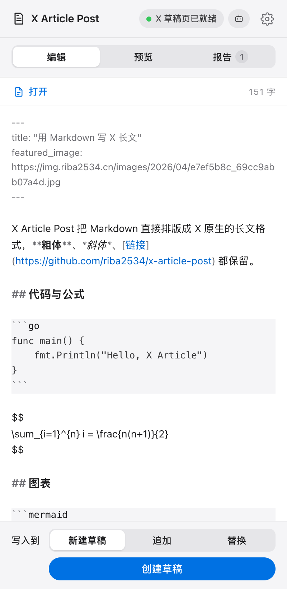
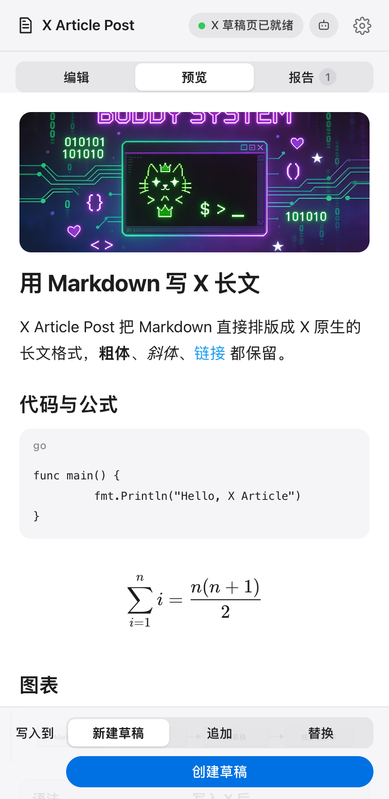
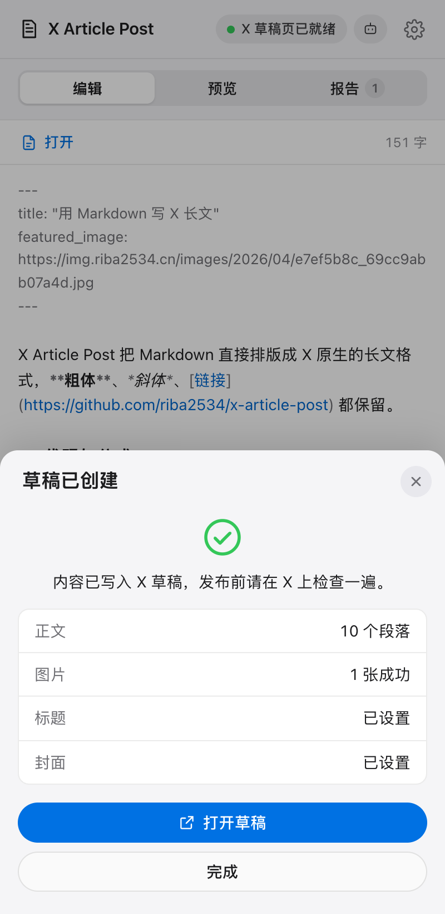

<p align="center">
  
</p>

<h1 align="center">X Article Post</h1>

<p align="center">
  <strong>用 Markdown 写 X 长文</strong>
  <br />
  在 Chrome 侧边栏写 Markdown，一键排版成 X Article 草稿。代码、表格、LaTeX、Mermaid、图片都能保留。
</p>

<p align="center">
  <a href="https://github.com/riba2534/x-article-post/releases/latest"></a>
  <a href="https://github.com/riba2534/x-article-post/actions/workflows/release.yml"></a>
  
  
  <a href="https://github.com/riba2534/x-article-post/stargazers"></a>
  <a href="LICENSE"></a>
</p>

<p align="center">
  <a href="#安装">安装</a> ·
  <a href="#使用">使用</a> ·
  <a href="#语法支持">语法支持</a> ·
  <a href="#给-agent-用">Agent API</a> ·
  <a href="#工作原理">工作原理</a> ·
  <a href="#开发">开发</a> ·
  <a href="#常见问题">常见问题</a>
</p>

---

X Article 的编辑器只认它自己的格式：粘贴 Markdown 会变成一堆符号，代码块、表格、公式要一个个从「插入」菜单手动加。X Article Post 把这一步自动化：你写 Markdown，它直接把内容写进 X 的编辑器，用的是 X 原生的标题、列表、代码块、表格、LaTeX 和图片，效果和手动排版一致。

**只创建草稿，从不发布。** 写完后在 X 里检查一遍，自己点发布。

<p align="center">
  
  
  
</p>

## 你可以做什么

| 功能 | 说明 |
|---|---|
| 一键生成草稿 | 新建草稿，或写入当前草稿（追加 / 替换） |
| 原生排版 | 标题、副标题、粗体、斜体、删除线、链接、引用、列表都使用 X 编辑器自带的格式 |
| 代码块 | 写成 X 原生代码块，带语言高亮；超长代码自动拆分 |
| 表格与公式 | GFM 表格转成 X 原生表格，`$$` 块级公式转成 X 原生 LaTeX |
| Mermaid | 在本地渲染成高清 PNG 后上传，支持流程图、时序图、状态图、饼图等 |
| 图片 | 自动下载、转换（SVG → PNG、超大图压缩）并上传到 X，按原位置插入 |
| 标题与封面 | 读取 front matter 的 `title` 和 `featured_image` / `cover` |
| 预览与报告 | 发布前预览 X 上的效果，列出所有被降级处理的语法 |
| Agent API | 本地 `xap` 进程提供 HTTP API，Claude Code 等 Agent 可以直接创建草稿 |

## 安装

需要 Chrome 116 或更新版本，并且已经在这个浏览器里登录 X。X Article 需要 X Premium。

1. 打开 [最新 Release](https://github.com/riba2534/x-article-post/releases/latest)，下载 `x-article-post-v<版本>.zip` 并解压。
2. 打开 `chrome://extensions`，开启右上角的「开发者模式」。
3. 点「加载已解压的扩展程序」，选择解压后的目录。
4. 点工具栏上的扩展图标，侧边栏就会打开。

更新时下载新版本，解压覆盖原目录，在 `chrome://extensions` 里点扩展卡片上的刷新按钮。

## 使用

1. 在侧边栏「编辑」页写 Markdown，或点「打开」选择 `.md` 文件，也可以直接把文件拖进来。内容会自动保存。
2. 切到「预览」看排版效果，「报告」里会列出哪些语法被调整了，以及调整方式。
3. 底部选择写入方式：
   - **新建草稿**：在 X 里创建一篇新草稿；
   - **追加**：写到当前打开的草稿末尾；
   - **替换**：覆盖当前草稿的正文（会先确认）。
4. 点「创建草稿」。扩展会切到 X 标签页完成写入，图片较多时需要几分钟。写入期间保持 X 标签页可见。
5. 完成后点「打开草稿」，检查无误后在 X 里发布。

**图片权限**：扩展默认只能访问 x.com。第一次写入带外链图片的文章时，Chrome 会请求读取这些图床的权限；也可以在「设置」里一次性允许读取所有网站的图片。

## 语法支持

X Article 原生支持的格式有限，不支持的会按下表自动转换。这些规则基于对 X 编辑器的实测，并用一个 197 篇文章的真实 Hugo 博客做过全量回归。

| Markdown | 写入 X 后 |
|---|---|
| front matter `title` / `featured_image` / `cover` | 文章标题 / 封面 |
| `#` ~ `######` | 文档里最高一级 → 标题，下一级 → 副标题，更深的 → 加粗段落 |
| `**粗体**` `*斜体*` `~~删除线~~` | 原生样式 |
| `` `行内代码` `` | X 不支持行内代码，默认保留反引号（可在设置里改成纯文本） |
| 链接、裸 URL | 原生链接；相对链接按「站点地址」补全，页内锚点只保留文字 |
| 单独一行的推文链接 | 嵌入推文 |
| 列表、任务列表 | 原生列表；`- [ ]` 显示为 ☐；编号不从 1 开始时保留原编号 |
| 嵌套列表 | 原生 Markdown 块，保留层级（也可以设置成展平） |
| 引用、GitHub Alert | 原生引用；`> [!NOTE]` 等转成带图标标签的引用 |
| 代码块 | 原生代码块，语言名映射到 X 支持的高亮语言 |
| ` ```mermaid ` | 渲染成 PNG 图片 |
| `$$…$$`、`\[…\]` | 原生 LaTeX 块 |
| `\(…\)` 行内公式 | 正文不支持行内公式：能用 Unicode 表示的直接转换（`O(n²)`、`α ≤ β`），复杂的保留 TeX 源码 |
| 表格 | 原生表格；单元格里有图片时整张表渲染成图片 |
| 图片、HTML `` | 上传到 X；失败时保留为链接文字 |
| `---` | 分割线 |
| 脚注 | 正文标 `[1]`，文末生成「注释」一节 |
| `<details>` | 展开：summary 变成加粗段落，内容照常转换 |
| `<sub>` `<sup>` `<br>` `:emoji:` | Unicode 上下标、段内换行、emoji |
| 中文段落内换行 | 按 Hugo `eastAsianLineBreaks` 规则直接拼接，不插入空格 |

## 给 Agent 用

Chrome 扩展本身无法监听端口，所以项目附带一个本地桥接进程 `xap`：它在 `127.0.0.1` 上提供 HTTP API，扩展通过 WebSocket 连接它。Agent 调用 API，扩展负责写入草稿。

```
Agent ──HTTP──▶ xap (127.0.0.1:17345) ◀──WebSocket── Chrome 扩展 ──▶ X Article 草稿
```

### 启动

需要 Node.js 22 或更新版本。从 Release 下载 `xap.mjs`：

```bash
node xap.mjs serve          # 启动桥接，首次运行会生成配对 token
node xap.mjs token          # 查看 token
```

在侧边栏「设置 → Agent 桥接」里打开开关，地址填 `ws://127.0.0.1:17345/ext`，Token 填上面的输出。顶栏出现「Agent 已连接」即配对成功。

### 命令行

```bash
node xap.mjs status                          # 检查桥接和扩展状态
node xap.mjs convert post.md                 # 预检：查看转换结果和降级提示
node xap.mjs draft post.md                   # 新建草稿
node xap.mjs draft post.md --title "标题"     # 覆盖标题
node xap.mjs draft post.md --article-id 1234567890 --mode append    # 写入已有草稿
```

### HTTP API

所有请求都需要 `Authorization: Bearer <token>`，token 保存在 `~/.config/x-article-post/token`。

| 方法 | 路径 | 说明 |
|---|---|---|
| `GET` | `/v1/status` | 桥接版本、扩展连接状态、X 标签页状态 |
| `POST` | `/v1/convert` | `{markdown, options?}` → 转换结果（不需要扩展在线） |
| `POST` | `/v1/drafts` | `{markdown, title?, articleId?, mode?, options?}` → 写入结果与草稿链接 |
| `GET` | `/v1/drafts/current` | 浏览器里当前打开的草稿 |

```bash
curl -s http://127.0.0.1:17345/v1/drafts \
  -H "Authorization: Bearer $(cat ~/.config/x-article-post/token)" \
  -H 'Content-Type: application/json' \
  -d "$(jq -n --rawfile md post.md '{markdown: $md}')"
```

完整的请求、响应和错误码见 [skills/x-article-post/references/api.md](skills/x-article-post/references/api.md)。

### Agent Skill

[`skills/x-article-post`](skills/x-article-post) 是一个符合 Claude Code Skill 规范的技能包，告诉 Agent 如何检查连接、预检、创建草稿以及处理错误。复制到 `~/.claude/skills/` 下即可使用；Release 里也有打包好的 `x-article-post-skill.zip`。

```bash
cp -R skills/x-article-post ~/.claude/skills/
```

**安全边界**：桥接只监听 `127.0.0.1`，HTTP 和 WebSocket 都校验 token，WebSocket 还会校验来源必须是 Chrome 扩展。API 只能创建和写入草稿，没有发布接口。

## 工作原理

X Article 的编辑器基于 Draft.js。扩展在 x.com 页面里找到编辑器的 React 实例，用它自己的数据结构直接构造内容块：

- 文本块、样式、链接直接写入 `EditorState`，由 X 自己保存；
- 代码块和表格使用 X 的 `MARKDOWN` 实体，公式使用 `LATEX` 实体，分割线和推文分别使用 `DIVIDER`、`TWEET` 实体，和 X「插入」菜单生成的结构一致；
- 图片交给 X 自己的上传流程，上传完成后放回原位置；
- 标题通过页面上的标题输入框设置，封面通过封面上传入口设置。

整个过程不调用 X 的私有 API，不读取或上传 Cookie。转换在本地完成，图片只发送到 X。

```
src/
  core/        Markdown → X 文档模型（纯函数，浏览器和 Node 通用）
  pipeline/    图片下载与转换、Mermaid / 表格渲染
  sidepanel/   侧边栏界面
  offscreen/   给 Agent 请求用的后台渲染页
  background/  写入编排、Agent 桥接客户端
  content/     x.com 内容脚本（隔离环境）
  main/        x.com 页面脚本（访问 Draft.js）
bridge/        xap 本地桥接（HTTP API + WebSocket + CLI）
skills/        Agent Skill
```

## 开发

```bash
npm ci
npm run build          # 构建扩展到 dist/，在 chrome://extensions 加载这个目录
npm run dev            # 监听源码变化并重新构建
npm test               # 单元测试
npm run typecheck
npm run build:bridge   # 构建 dist-bridge/xap.mjs
npm run bridge         # 从源码运行 xap serve
```

用自己的 Markdown 语料做回归：

```bash
BLOG_DIR=~/path/to/blog/content npx vitest run tests/core
```

每次推送到 `main`，GitHub Actions 会先跑类型检查和测试，然后构建并自动发布 Release。版本号是 `package.json` 里的主次版本号加上提交数，例如 `v1.0.42`。

## 常见问题

**点了「创建草稿」没有反应？** 确认浏览器里已登录 X，并且账号能使用 Articles（X Premium）。写入时扩展会切到 X 标签页，X 的编辑器在后台标签页里不渲染，所以写入期间不要切走或最小化窗口。

**有些图片没传上去？** 外链图片可能已失效或有防盗链。失败的图片会保留为 Markdown 链接，结果页和「报告」里会列出原因。也可能是没有授予图床权限，在「设置」里开启「允许读取所有网站图片」。

**三级标题怎么变成加粗了？** X Article 只有标题和副标题两级。更深的标题会变成加粗段落，层级关系按文档里实际用到的标题等级计算。

**行内代码为什么带反引号？** X 正文不支持行内代码样式，保留反引号是为了让读者看出这是代码。不想要的话，在「设置」里改为「纯文本」。

**会不会误发布？** 不会。扩展和 API 都没有发布功能，只写草稿。

**X 改版后不能用了？** 扩展依赖 X 编辑器的内部结构，X 改版后可能失效。请在 [Issues](https://github.com/riba2534/x-article-post/issues) 反馈，附上浏览器控制台里的错误信息。

## 许可

[MIT](LICENSE)
