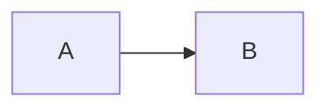

> 这是一段引言，说明本文的**目的**。

## 一、基础格式

普通段落里有**粗体**、*斜体*、***粗斜体***、~~删除线~~和 `行内代码`。
中文软换行会直接拼接，
English soft breaks become spaces.

行尾两个空格  
产生硬换行。

### 1.1 链接

访问 [我的博客](/about/) 或者 https://example.com/path ，也可以看 <https://example.org>。
页内跳转 [回到顶部](#top) 只保留文字。

#### 更深的标题

徽章 [](https://ci.example.com)。

## 二、列表

- 苹果
- 香蕉
- [x] 已完成
- [ ] 未完成

3. 第三步
4. 第四步

嵌套列表：

1. 外层
   - 内层 \(a_1 + a_2\)
   - 另一项
2. 外层二

## 三、引用与提示

> [!TIP]
> 善用快捷键可以**事半功倍**。

> 引用中的列表：
> - 第一点
> - 第二点

## 四、代码

```golang
package main

func main() {
	println("你好")
}
```



## 五、数学

勾股定理 \(a^2 + b^2 = c^2\)，分数 \(\frac{1}{2}\)。

$$
\sum_{i=1}^{n} i = \frac{n(n+1)}{2}
$$

## 六、表格

| 名称 | 说明 | 数量 |
|:---|:---:|---:|
| **甲** | 第一行<br>第二行 | 10<sup>3</sup> |
| `a\|b` | [链接](https://example.com) | H<sub>2</sub>O |

## 七、图片与 HTML


 小图标会被丢弃。

<details>
<summary>点击展开</summary>

```bash
echo "$HOME"
```

</details>

<center><font color="red">居中的红字</font></center>

## 八、其他

正文引用脚注[^1]，以及表情 :tada:。

---

https://x.com/example/status/1234567890

[^1]: 这是脚注内容，带 [链接](https://example.com/note)。
